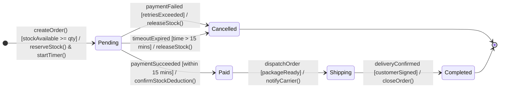

# State Machine Diagram - Order

## 1. Overview

This diagram describes the lifecycle of an Order
in the Flash Sale E-commerce system.

## 2. State Machine Diagram

## 3. State Descriptions

| State | Description |
|---|---|
| Pending | Order created, stock temporarily reserved |
| Paid | Payment successful |
| Cancelled | Order cancelled and reserved stock released |
| Shipping | Order dispatched to carrier |
| Completed | Order successfully delivered |

## 4. Events and Actions

| Event | Guard Condition | Action |
|---|---|---|
| createOrder() | stockAvailable >= qty | reserveStock(), startTimer() |
| paymentSucceeded | within 15 mins | confirmStockDeduction() |
| paymentFailed | retriesExceeded | releaseStock() |
| timeoutExpired | time > 15 mins | releaseStock() |
| dispatchOrder | packageReady | notifyCarrier() |
| deliveryConfirmed | customerSigned | closeOrder() |

## 5. Business Rules

- An Order starts in Pending state.
- Stock must be reserved before payment processing.
- Payment must succeed within 15 minutes.
- Failed or expired orders must release reserved stock.
- A successfully paid order can enter Shipping.
- A delivered order enters Completed.
