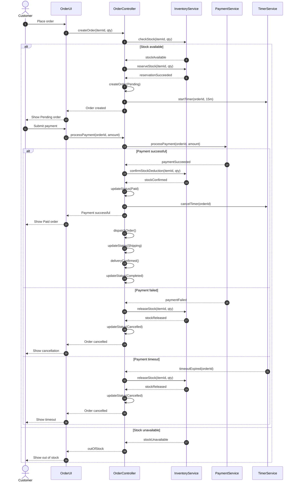

# Sequence Diagram - Order Processing

## 1. Overview

This sequence diagram describes the interaction between system components during the order lifecycle in the Flash Sale E-commerce system.

It includes:
- Successful order and payment.
- Payment failure.
- Payment timeout after 15 minutes.
- Stock unavailable.
- Automatic stock release.

## 2. Participants

| Participant | Responsibility |
|---|---|
| Customer | Initiates an order |
| OrderUI | Receives customer requests |
| OrderController | Controls order processing |
| InventoryService | Checks, reserves, and releases stock |
| PaymentService | Processes payments |
| TimerService | Tracks the 15-minute timeout |

## 3. Sequence Diagram

## 4. Scenario Descriptions

### Scenario 1: Successful Payment

1. Customer places an order.
2. System checks product availability.
3. System reserves stock.
4. Order is created with Pending status.
5. Timer starts for 15 minutes.
6. Customer completes payment successfully.
7. System confirms stock deduction.
8. Timer is cancelled.
9. Order changes to Paid.
10. Order is dispatched and changes to Shipping.
11. Delivery is confirmed and order changes to Completed.

### Scenario 2: Payment Failed

1. Customer places an order.
2. System reserves stock.
3. Order is created with Pending status.
4. Payment processing fails.
5. System releases reserved stock.
6. Order changes to Cancelled.

### Scenario 3: Payment Timeout

1. Customer places an order.
2. System reserves stock.
3. Timer starts for 15 minutes.
4. Customer does not complete payment within 15 minutes.
5. Timer triggers timeoutExpired.
6. System releases reserved stock.
7. Order changes to Cancelled.

### Scenario 4: Stock Unavailable

1. Customer places an order.
2. System checks product availability.
3. Stock is insufficient.
4. System rejects the order.
5. Customer receives an out-of-stock notification.

## 5. Main Business Rules

1. Stock must be available before reservation.
2. Stock must be reserved before payment.
3. A new order starts with Pending status.
4. Payment must succeed within 15 minutes.
5. Failed payment triggers stock release.
6. Timeout triggers automatic stock release.
7. Successful payment changes Order status to Paid.
8. Cancelled orders must not retain reserved stock.

## 6. Conclusion

The sequence diagram illustrates the interaction between the Customer, OrderUI, OrderController, InventoryService, PaymentService, and TimerService.

It describes four main scenarios: successful payment, payment failure, payment timeout, and stock unavailable.

The system ensures proper stock reservation, payment processing, and order status management throughout the order lifecycle.
