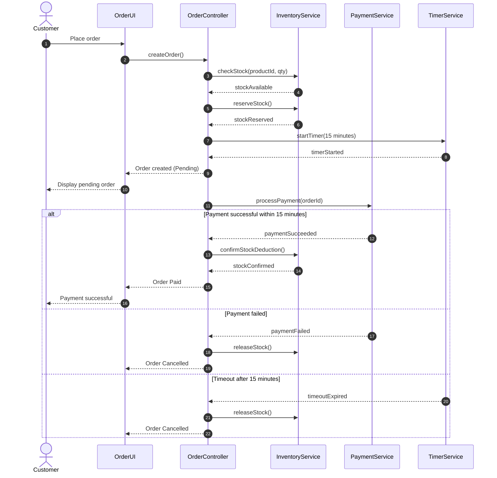

# Sequence Diagram - Order

## 1. Overview

This sequence diagram describes the interaction between system components during the order lifecycle in the Flash Sale E-commerce system.

## 2. Participants

- Customer
- OrderUI
- OrderController
- InventoryService
- PaymentService
- TimerService

## 3. Sequence Diagram

## 4. Scenario Descriptions

### Scenario 1: Successful Payment

1. Customer places an order.
2. System checks product availability.
3. System reserves stock.
4. Timer starts for 15 minutes.
5. Customer completes payment successfully.
6. System confirms stock deduction.
7. Timer is cancelled.
8. Order changes to Paid.

### Scenario 2: Payment Failed

1. Customer places an order.
2. System reserves stock.
3. Customer attempts payment.
4. Payment fails.
5. System releases reserved stock.
6. Order changes to Cancelled.

### Scenario 3: Payment Timeout

1. Customer places an order.
2. System reserves stock.
3. Timer starts for 15 minutes.
4. Customer does not complete payment within 15 minutes.
5. Timer triggers timeoutExpired.
6. System cancels payment.
7. System releases reserved stock.
8. Order changes to Cancelled.

## 5. Conclusion

The sequence diagram illustrates the interaction between the Customer, OrderUI, OrderController, InventoryService, PaymentService, and TimerService.

It describes three main scenarios: successful payment, payment failure, and payment timeout.

The system ensures proper stock reservation, payment processing, and order status management throughout the order lifecycle.
