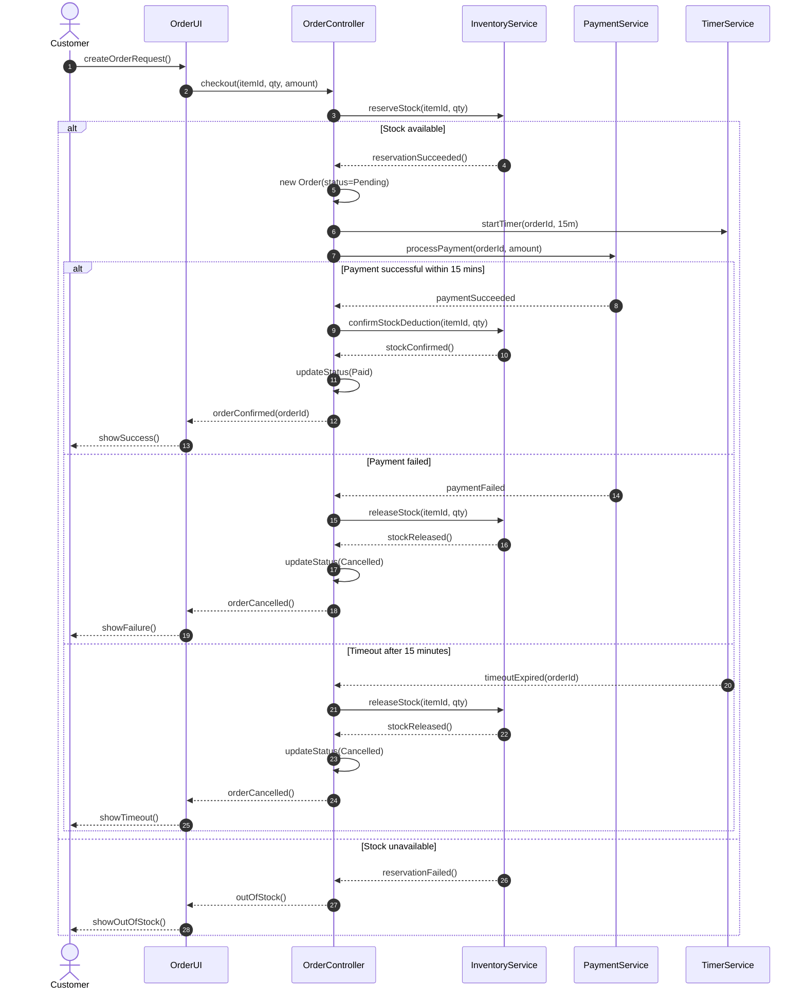

# Sequence Diagram - Order Processing

## 1. Overview

This diagram describes the order processing workflow
in the Flash Sale E-commerce system.

It includes:
- Successful order and payment.
- Payment failure.
- Payment timeout after 15 minutes.
- Automatic stock release.

## 2. Sequence Diagram

## 3. Participants

| Participant | Responsibility |
|---|---|
| Customer | Initiates an order |
| OrderUI | Receives customer requests |
| OrderController | Controls order processing |
| InventoryService | Reserves and releases stock |
| PaymentService | Processes payments |
| TimerService | Tracks the 15-minute timeout |

## 4. Main Business Rules

1. Stock must be reserved before payment.
2. A new order starts with Pending status.
3. Payment must succeed within 15 minutes.
4. Failed payment triggers stock release.
5. Timeout triggers automatic stock release.
6. Successful payment changes Order status to Paid.
7. Cancelled orders must not retain reserved stock.
