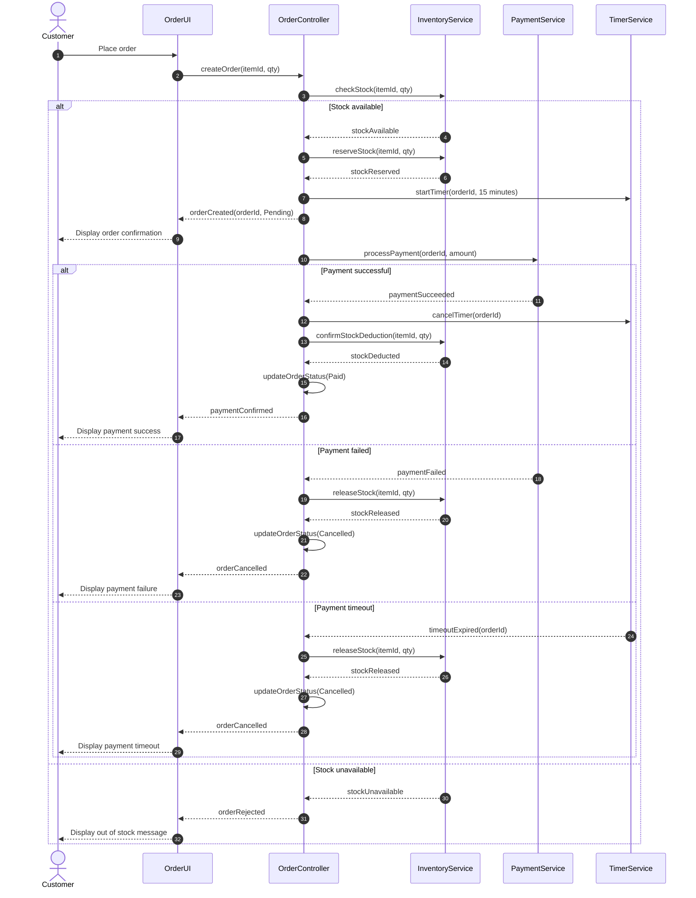

# Sequence Diagram - Order Processing

## 1. Overview

This sequence diagram describes the order processing flow in the Flash Sale E-commerce system.

It includes:
- Successful order and payment.
- Payment failure.
- Payment timeout after 15 minutes.
- Stock unavailable.

## 2. Participants

| Participant | Description |
|---|---|
| Customer | Places an order |
| OrderUI | User interface |
| OrderController | Handles order processing |
| InventoryService | Checks and manages stock |
| PaymentService | Processes payment |
| TimerService | Manages payment timeout |

## 3. Sequence Diagram

## 4. Main Scenarios

### Scenario 1: Successful Payment
1. Customer places an order.
2. System checks and reserves available stock.
3. Timer starts for 15 minutes.
4. Payment is successful.
5. System confirms stock deduction.
6. Order status changes to Paid.

### Scenario 2: Payment Failure
1. Payment service returns paymentFailed.
2. System releases reserved stock.
3. Order status changes to Cancelled.
4. Customer receives a failure notification.

### Scenario 3: Payment Timeout
1. Customer does not complete payment within 15 minutes.
2. Timer service sends timeoutExpired.
3. System releases reserved stock.
4. Order status changes to Cancelled.
5. Customer receives a timeout notification.

## 5. Conclusion

The sequence diagram demonstrates how the system processes orders, handles payment results, and releases reserved stock when payment fails or times out.
